<picture>
  <source media="(prefers-color-scheme: dark)" srcset="./cards/hero-dark.svg">
  
</picture> 
<picture>
  <source media="(prefers-color-scheme: dark)" srcset="./cards/heatmap-dark.svg">
  
</picture> 
<picture>
  <source media="(prefers-color-scheme: dark)" srcset="./cards/activity-dark.svg">
  
</picture> 
 
<picture>
  <source media="(prefers-color-scheme: dark)" srcset="./cards/title-coding-dark.svg">
  
</picture> 
<a href="https://github.com/MBN4/Ai-Business-Analyst"><picture><source media="(prefers-color-scheme: dark)" srcset="./cards/repo-Ai-Business-Analyst-dark.svg"></picture></a><a href="https://github.com/MBN4/circle-the-ai-universe"><picture><source media="(prefers-color-scheme: dark)" srcset="./cards/repo-circle-the-ai-universe-dark.svg"></picture></a> <a href="https://github.com/MBN4/ReelBite"><picture><source media="(prefers-color-scheme: dark)" srcset="./cards/repo-ReelBite-dark.svg"></picture></a><a href="https://github.com/MBN4/Kitchens"><picture><source media="(prefers-color-scheme: dark)" srcset="./cards/repo-Kitchens-dark.svg"></picture></a> 

<a href="https://github.com/MBN4">github.com/MBN4</a> &nbsp;/&nbsp; <a href="https://linkedin.com/in/bilal-nadeem">linkedin</a>

