

<picture>
  <source media="(prefers-color-scheme: dark)" srcset="./cards/hero-dark.svg">
  
</picture> 
<picture>
  <source media="(prefers-color-scheme: dark)" srcset="./cards/heatmap-dark.svg">
  
</picture> 
<picture>
  <source media="(prefers-color-scheme: dark)" srcset="./cards/activity-dark.svg">
  
</picture> 
 
<!-- extras:start -->

<picture><source media="(prefers-color-scheme: dark)" srcset="./cards/sect-projects-dark.svg"></picture>

<a href="https://github.com/MBN4/Ai-Business-Analyst"><picture><source media="(prefers-color-scheme: dark)" srcset="./cards/proj-ai-business-analyst-dark.svg"></picture></a>
<a href="https://github.com/MBN4/circle-the-ai-universe"><picture><source media="(prefers-color-scheme: dark)" srcset="./cards/proj-circle-the-ai-universe-dark.svg"></picture></a>

<a href="https://github.com/MBN4/ReelBite"><picture><source media="(prefers-color-scheme: dark)" srcset="./cards/proj-reelbite-dark.svg"></picture></a>
<a href="https://github.com/MBN4/Kitchens"><picture><source media="(prefers-color-scheme: dark)" srcset="./cards/proj-kitchens-dark.svg"></picture></a>

 

<picture><source media="(prefers-color-scheme: dark)" srcset="./cards/sect-terminal-dark.svg">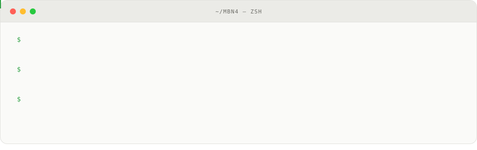</picture>

<picture><source media="(prefers-color-scheme: dark)" srcset="./cards/sect-marquee-dark.svg"></picture>

<picture><source media="(prefers-color-scheme: dark)" srcset="./cards/sect-orbit-dark.svg">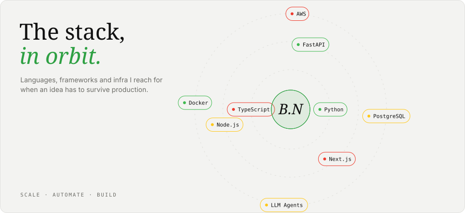</picture>

<!-- extras:end -->
<!-- extras2:start -->

<picture><source media="(prefers-color-scheme: dark)" srcset="./cards/sect-pipeline-dark.svg"></picture>

<picture><source media="(prefers-color-scheme: dark)" srcset="./cards/sect-code-dark.svg">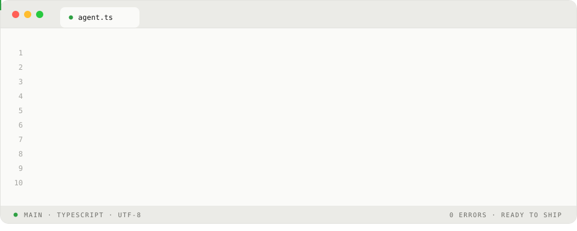</picture>

<picture><source media="(prefers-color-scheme: dark)" srcset="./cards/sect-neural-dark.svg"></picture>

<picture><source media="(prefers-color-scheme: dark)" srcset="./cards/sect-rhythm-dark.svg">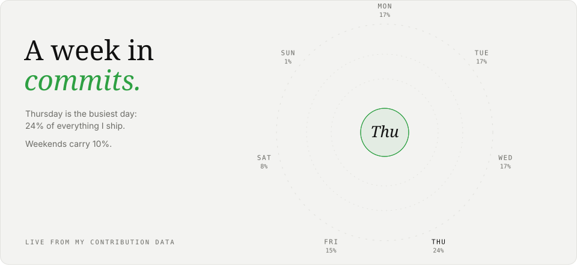</picture>

<a href="https://linkedin.com/in/bilal-nadeem"><picture><source media="(prefers-color-scheme: dark)" srcset="./cards/sect-cta-dark.svg"></picture></a>

<!-- extras2:end -->

<a href="https://github.com/MBN4">github.com/MBN4</a> &nbsp;/&nbsp; <a href="https://linkedin.com/in/bilal-nadeem">linkedin</a>

